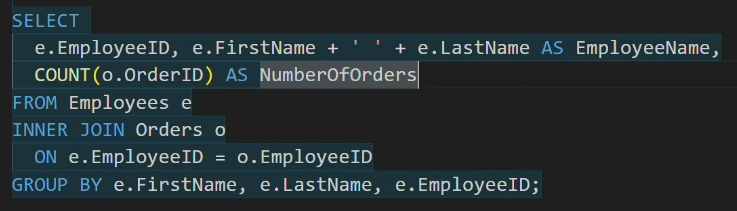
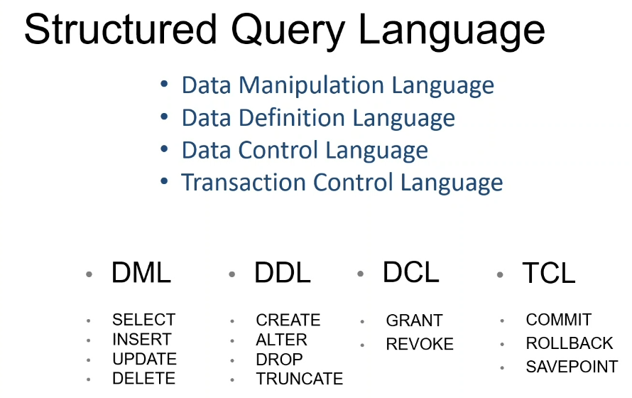
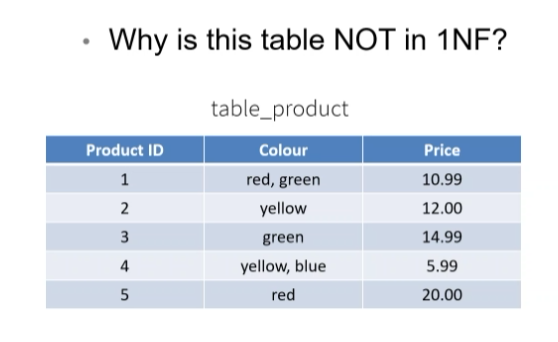
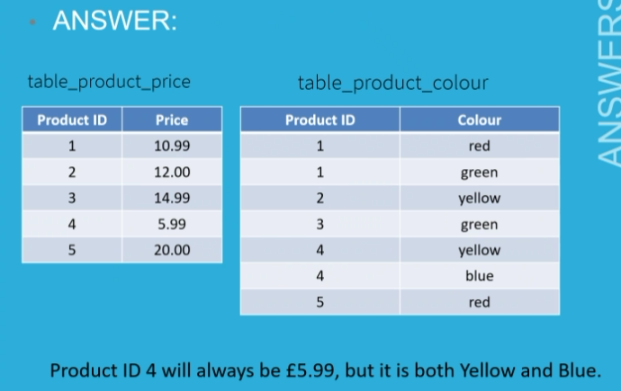
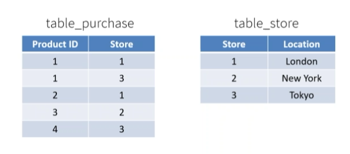

# SQL JOINS CONTINUTED

Task:
write a new query to get total price that considers the discount applied

```
SELECT o.OrderID, SUM(od.UnitPrice * od.Quantity * (1-od.Discount)) AS TotalPrice
FROM Orders o
INNER JOIN [Order Details] od
    ON o.OrderID = od.OrderID
GROUP BY o.OrderID;
```

## Orders per employee



## Top 5 customers by spend

```
SELECT TOP 5
    c.CompanyName,
    SUM(od.Quantity * od.UnitPrice) AS TotalSpend
FROM Customers c
INNER JOIN Orders o
    ON c.CustomerID = o.CustomerID
INNER JOIN [Order Details] od
    ON o.OrderID = od.OrderID
GROUP BY c.CompanyName
ORDER BY TotalSpend DESC;
```

## Total revenue for each product category

```
SELECT
    cat.CategoryName,
    SUM(od.Quantity * od.UnitPrice) AS Revenue
FROM Categories cat
INNER JOIN Products p
    ON cat.CategoryID = p.CategoryID
INNER JOIN [Order Details] od
    ON p.ProductID = od.ProductID
GROUP BY cat.CategoryName;
```

## Full Order Breakdown
Create a table showing:

OrderID
Customer Name
Product Name
Quantity
Unit Price


```
SELECT od.OrderID, c.CompanyName, p.ProductName, od.Quantity, od.UnitPrice
From [Order Details] od
INNER JOIN Products p
ON od.ProductID = p.ProductID
INNER JOIN Orders o
ON od.OrderID = o.OrderID
INNER JOIN Customers c
ON o.CustomerID = c.CustomerID]
```

## Advanced — Average Order Value per Customer
For each customer, show:

Number of orders
Total spend
Average order value


```
USE Northwind
GO
SELECT c.CompanyName, COUNT(o.OrderID),
SUM(od.UnitPrice * od.Quantity * (1 - od.Discount)) AS TotalSpend,
SUM(od.UnitPrice * od.Quantity * (1 - od.Discount))/COUNT(o.OrderID) AS Average_Order_Value
FROM Customers c
INNER JOIN Orders AS o
    ON c.CustomerID = o.CustomerID
INNER JOIN [Order Details] AS od
    ON o.OrderID = od.OrderID
GROUP BY c.CompanyName
```

## Employees with no orders

SELECT e.EmployeeID, e.FirstName, e.LastName
FROM Employees e
LEFT JOIN Orders o ON e.EmployeeID = o.EmployeeID
WHERE o.OrderID IS NULL;

## Most popular product

## Orders with shipping company


# Content learning

CRUD - create read update delete



# Creating tables

```
CREATE TABLE film_table
(
filmID INT IDENTITY (1,1) PRIMARY KEY,
film_name VARCHAR (200) NOT NULL,
film_type VARCHAR (50),
date_of_release DATE,
director VARCHAR (100),
writer VARCHAR (100),
star VARCHAR (100),
film_language VARCHAR (50),
official_website VARCHAR (255),
plot_summary VARCHAR (MAX)

);

SELECT *
FROM film_table;
```

Then once created you can use ALTER TABLE to change things

You can use NVARCHAR which is just VARCHAR but allows use of certain symbols like #

INSERT INTO film_table
(
        column_first, column_last, ...
)
VALUES
(
    'value1', 'value2', ...
)

```
USE Films
GO

INSERT INTO dbo.film_table (
    film_name, 
    film_type, 
    date_of_release, 
    director, 
    writer, 
    star, 
    film_language, 
    official_website ) 

VALUES (
    'Shrek', 
    'Animation', 
    '2001-05-18', 
    'Andrew Adamson', 
    'Ted Elliott', 
    'Mike Myers', 
    'English', 
    'https://www.dreamworks.com/movies/shrek'
    );
 ```


## Normalisation

If we are at a large scale data set, can we reduce the size to save costs of storage and reduce data redundancy, and get rid of dupilcates.

If something is not normalised, a positive is that you can see all the data on one table

The downside is ease of querying as there is just too much information to sift through

### 1st normal form



The colour values are multiple.



### 2nd normal form



All non-key attributes must functionally depend upon the full primary key

### 3rd normal form

No transitive dependencies, e.g. it needs to be column one is determined by column 2, which is determined by column 1

## ERD Entity Relationship Diagrams

Entities are tables

Use drawio

FK and PK next to foreign and primary key columns, and the crows foot should come out of the corresponding keys

## Transactions

A transaction is any operation that is treated as a single unit of work, which either completes fully or does not complete at all, and leaves the storage system in a consistent state. E.g. sending money out of your bank, it either sends or doesn't.

## ACID properties

### Atomicity
Each statement in a transaction is treated as a single unit. Either the entire statement is executed, or none of it is. E.g. if there is a power cut, the transaction either happened or not. Stops data loss and corruption.

### Consistency
Ensures transactions only make changes in tables in predefinied, predictable ways.Stops corruption or unintended consequences.

### Isolation
When multiple users are reading and writing from the same table at once, isolation means that transactions don't interfere with each other. They must occur one by one, not simultaneously.

### Durability
Ensures that changes to data are made successfully executed and saved.

## Stored Procedures

A named script or task that can be saved and returned back to in the server. Increases consistency, since it's reusable, any changes need to be made where the stored procedure is, increases security as people can't access the database but can access the stored procedures.

Use @ to create names and copy their data types from the columns

AS says the logic will be followed

```
USE Northwind
GO

CREATE PROCEDURE UpdateCustomerPhone
	@CustomerID CHAR(5),
	@NewPhone VARCHAR(24)
AS
BEGIN
	UPDATE Customer
	SET Phone = @NewPhone
	WHERE CustomerID = @CustomerID
END;
```
```
EXECUTE UpdateCustomerPhone
    @CustomerID = 'ALFKI',
    @NewPhone = '0121-555-33333';
```


```
CREATE PROCEDURE GetCustomerContactName
    @CustomerID NCHAR(5)
AS
BEGIN
   SELECT ContactName
   FROM Customers
   WHERE CustomerID = @CustomerID;
END;
GO

EXEC GetCustomerContactName @CustomerID = 'ALFKI';
```

## CASE STATEMENTS
```
SELECT CASE
WHEN ____ THEN ____
ELSE ____
END
FROM Orders
```
that is the format, returned result is boolean

```
SELECT CASE
WHEN DATEDIFF(d, OrderDate, ShippedDate) < 10 THEN 'On Time'
ELSE 'Overdue'
END AS "Shipping status"
FROM Orders
```

Use CASE to add a column to the previous activity solution called Retirement Status as follows:

Age greater than 65 = ”Retired”
2. Age greater than 60 = “Retirement due”
3. Age less than 60 = “More than 5 years to go”

```
SELECT FirstName + ' ' + LastName AS "Employee Name",
CASE 
WHEN FLOOR(DATEDIFF(d, BirthDate, GETDATE())/365.25) > 65 THEN 'Retired'
WHEN FLOOR(DATEDIFF(d, BirthDate, GETDATE())/365.25) > 60 THEN 'Retirement due'
ELSE 'More than 5 years ago'
END AS "Retirement Status"
FROM Employees;
```

drawio