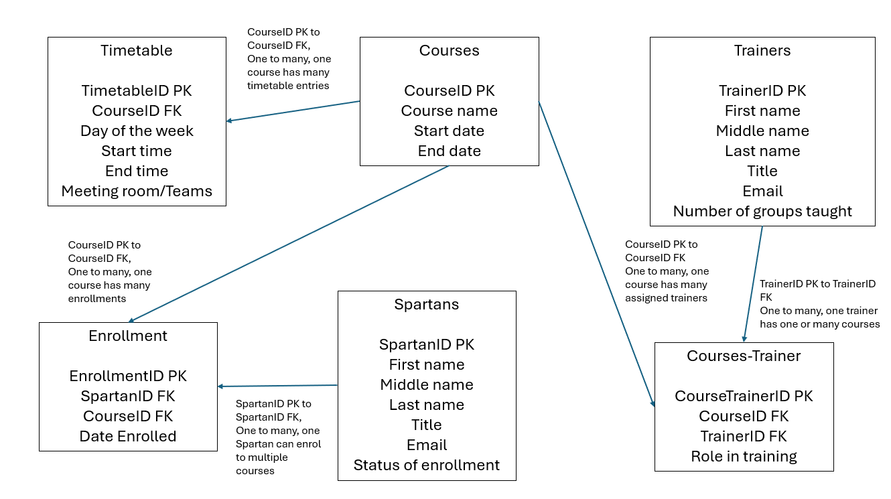

# SQL Practical Exercise

## 1.1 Creating the tables

```
CREATE TABLE course_table
(
CourseID INT IDENTITY (1,1) PRIMARY KEY,
course_name VARCHAR (200) NOT NULL,
trainer VARCHAR (50),
start_date DATE,
course_description VARCHAR (MAX)

);

SELECT *
FROM course_table;
```

```
CREATE TABLE spartans_table
(
SpartanID INT IDENTITY (1,1) PRIMARY KEY,
first_name VARCHAR (100) NOT NULL,
middle_name VARCHAR (100),
last_name VARCHAR (100) NOT NULL,
CourseID INT,

CONSTRAINT spartans_tableFK FOREIGN KEY (CourseID)
	REFERENCES course_table(CourseID)

);

SELECT *
FROM spartans_table;
```

## 1.2 Adding data

Inserting the four courses

```
INSERT INTO course_table (course_name, trainer, start_date, course_description)
VALUES 
    ('C# Software Engineering', 'Tim Corey', '2026-01-12', 'Comprehensive object-oriented programming with C# and .NET Core.'),
    ('Data Engineering', 'Alex Freberg', '2026-02-02', 'Mastering SQL Server, ETL pipelines, and data warehousing principles.'),
    ('DevOps & Cloud', 'Nana Janashia', '2026-03-01', 'Cloud infrastructure, CI/CD pipelines, Docker, and Kubernetes fundamentals.'),
    ('Cyber Security', 'John Hammond', '2026-03-15', 'Network security, ethical hacking, and threat mitigation strategies.');
```

Inserting 10 Spartans

```
INSERT INTO spartans_table (first_name, middle_name, last_name, CourseID)
VALUES 
    ('James', 'Alexander', 'Carter', 1),
    ('Sophie', 'Marie', 'Bennett', 1),
    ('Liam', NULL, 'O''Connor', 1),
    ('Amara', 'Kaur', 'Patel', 2),
    ('Marcus', 'Anthony', 'Vance', 2),
    ('Elena', NULL, 'Rostova', 2),
    ('David', 'Edward', 'Miller', 3),
    ('Aisha', 'Fatima', 'Khan', 3),
    ('Lucas', 'Gabriel', 'Silva', 4),
    ('Chloe', NULL, 'Taylor', 4);
```

Viewing the data joined together

```
SELECT 
    s.SpartanID,
    s.first_name,
    s.middle_name,
    s.last_name,
    c.course_name,
    c.trainer,
    c.start_date
FROM spartans_table s
LEFT JOIN course_table c ON s.CourseID = c.CourseID;
```

## 1.3 Modifying tables
### a) Add a tittle column to the Spartans table

```
ALTER TABLE spartans_table
ADD title VARCHAR(10);
GO

SELECT * 
FROM spartans_table;
```

then adding the data
```
UPDATE spartans_table
SET title = CASE SpartanID
    WHEN 1 THEN 'Mr'
    WHEN 2 THEN 'Ms'
    WHEN 3 THEN 'Mr'
    WHEN 4 THEN 'Ms'
    WHEN 5 THEN 'Mr'
    WHEN 6 THEN 'Dr'
    WHEN 7 THEN 'Mr'
    WHEN 8 THEN 'Mx'
    WHEN 9 THEN 'Mr'
    WHEN 10 THEN 'Ms'
END;
GO

SELECT 
    SpartanID, 
    title, 
    first_name, 
    last_name, 
    CourseID
FROM spartans_table;
```

### b) Add a check constraint to title and test

```
ALTER TABLE spartans_table
ADD CONSTRAINT check_spartans_title 
CHECK (Title IN ('Mr', 'Ms', 'Mx', 'Dr', 'Prof'));
GO
```
```
INSERT INTO spartans_table (first_name, last_name, title, CourseID)
VALUES ('Arthur', 'Morgan', 'King', 1);
```
error:

Msg 547, Level 16, State 0, Line 1
The INSERT statement conflicted with the CHECK constraint "check_spartans_title". The conflict occurred in database "Spartan Database", table "dbo.spartans_table", column 'title'.
The statement has been terminated.

### c) Add an email column to the Spartans table, and make sure two Spartans can't have the same email

Creating the email:
```
ALTER TABLE spartans_table
ADD Email VARCHAR(100);
GO
SELECT * FROM spartans_table;
```
Inputting the email data in a simple format for this scenario (so just using firstandlastname@spartaglobal.com)
```
UPDATE spartans_table
SET Email = LOWER(first_name + '.' + last_name + '@spartaglobal.com');
GO
SELECT * FROM spartans_table;
```
Making it unique for each email input:
```
ALTER TABLE spartans_table
ADD CONSTRAINT Unique_Spartans_Email UNIQUE (Email);
GO
```

### d) Add an end date column and add a constraint so that the end date can't fall before a start date

```
ALTER TABLE course_table
ADD end_date DATE;
GO
SELECT * FROM course_table;
```
Adding data using DATEADD, eight weeks after the start date
```
UPDATE course_table
SET end_date = DATEADD(week, 8, start_date);
GO
SELECT CourseID, course_name, start_date, end_date 
FROM course_table;
```
Adding the constraint, greater than or equal in case a course is one day long
```
ALTER TABLE course_table
ADD CONSTRAINT check_course_dates 
CHECK (end_date >= start_date);
GO
SELECT * FROM course_table;
```

### e) Increase the length of the course name column

```
ALTER TABLE course_table
ALTER COLUMN course_name VARCHAR(500) NOT NULL;
GO
SELECT * 
FROM course_table;
```
Refreshing the database will now list it as 500 characters.

### f) Status column, with default value

Adding the column and the default constraint:

```
ALTER TABLE spartans_table
ADD Status VARCHAR(20) CONSTRAINT default_spartans_status DEFAULT 'Active';
GO
SELECT * FROM spartans_table;
```
Checking by adding a new worker:
```
INSERT INTO spartans_table (Title, first_name, last_name, Email, CourseID)
VALUES ('Mr', 'Kendrick', 'Lamar', 'kendrick.lamar@spartaglobal.com', 1);
SELECT SpartanID, Title, first_name, last_name, Email, Status 
FROM spartans_table
WHERE Email = 'kendrick.lamar@spartaglobal.com';
```
The status was active.

### g) Making the last name mandatory but checking the table is fine first

To check if existing rows break the rule:
```
SELECT SpartanID, first_name, middle_name, last_name 
FROM spartans_table
WHERE last_name IS NULL;
```
It was empty, so I can proceed:
```
ALTER TABLE spartans_table
ALTER COLUMN last_name VARCHAR(100) NOT NULL;
GO
```

Now last name cannot be null.

### h) Rename a column and remove a column

Rename, using a built in store procedure called sp_rename

```
EXEC sp_rename 'course_table.start_date', 'course_start_date', 'COLUMN';
GO
SELECT * 
FROM course_table;
```
start_date became renamed to course_start_date

```
ALTER TABLE course_table
DROP COLUMN course_description;
GO
SELECT * 
FROM course_table;
```
This removed the course description column I created.

## Extension:
Changes are safer to make with ALTER TABLE than by dropping and recreating a table as there is no warning message that prompts when dropping a table and it happens quickly, so it is highly risky to do compared to altering a single or few changes of the table. Dropping a table is completely irreversible.

## 1.4 Designing an improved database



This is what I came up with, with relationship labels to the table entities.