# SQL JOINS

## What are JOINS and how do they work?

It is a keyword that is used to combine matched rows from two or more tables.

They let you make a list of combined rows from data.

The inner JOIN are the matched rows of the tables, the overlap of them.
Venn diagram example:

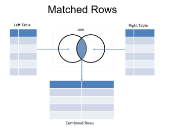


Now using the example:

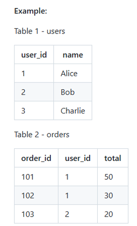

### Inner JOIN

To get a list of users and all of their orders:

```
SELECT
    users.name,
    orders.order_id,
    orders.total
FROM users
INNER JOIN orders
    ON users.user_id - orders.user_id;
```

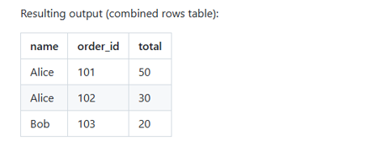

### Left JOIN

Give me everything from the left table, and only the matched joins from the right table.
In the example, Charlie is back in the new table, but his values are NULL, as those values do not exist.

```
SELECT
    users.name,
    orders.order_id,
    orders.total
FROM users
LEFT JOIN orders
    ON users.user_id - orders.user_id;
```

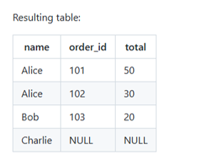

Note: the FROM is the left table, the other is the right table.

Back to the example, it could be good to find the users that do not have any values, so finding Charlie who has NULL values to spot issues.

### Right JOIN

Same as the left JOIN; give me everything from the right table, and only the matched joins from the left table.

In the example, Charlie doesn't exist in the right join, same as inner join, but he exists in the left join.

The right join is used less frequently than using the left.

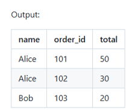

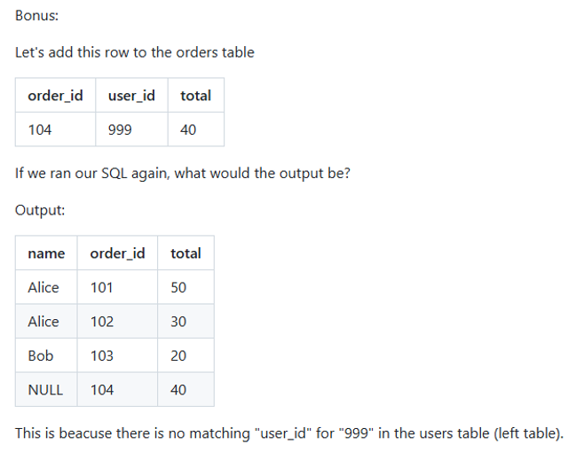

### Full JOIN

Takes all the rows from both tables.

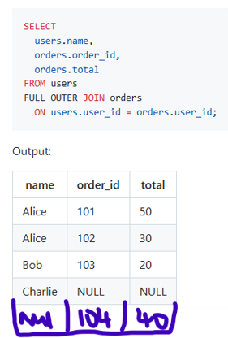

## Summary and why use JOINs?

Joins help to pull bits of information from relational tables when they are needed to be viewed or analysed. It helps eliminate duplicate data, update records faster, and answer complex business questions from merging different sets of data.

* INNER JOIN = Matches only
* LEFT JOIN = All left + matched right
* RIGHT JOIN = All right + matched left
* FULL JOIN = Everything

## SQL Practice
### Example 1: Orders with Customer Names

```
SELECT c.CompanyName, o.OrderID, o.OrderDate
FROM Customers c
INNER JOIN Orders o
	ON c.CustomerID = o.CustomerID;
 ```

The c._____ are aliases, they are just for efficiency in making you not have to write out the full names always. It lets you reference the table without writing out the full name (but you don't have to use them, it's worth getting used to though you might have to on the job).
For example, here c.CompanyName means 'go to the table c (customers) and pull the CompanyName column'.
This is how it is written in full:

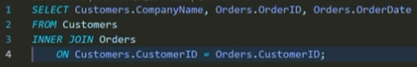

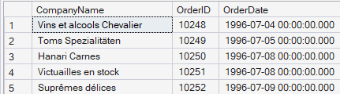

### Example 2: Orders with Product Names
```
SELECT o.OrderID, p.ProductName, od.Quantity
FROM Orders o
INNER JOIN [Order Details] od
	ON o.OrderID = od.OrderID
INNER JOIN Products p
	ON od.ProductID = p.ProductID;
```
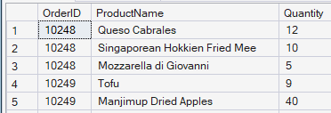

This is a junction table, a combination of tables, think of it like a roundabout or junction on a road.

### Example 3: Order Totals
```
SELECT o.OrderID, SUM(od.Quantity * od.UnitPrice) AS OrderTotal
FROM Orders o
INNER JOIN [Order Details] od
	ON o.OrderID = od.OrderID
GROUP BY o.OrderID;
```

This gives us the total amount of orders.
Remember to use AS to give the new column a name.
Group by controls the level, without it we would get all orders.

This gives us

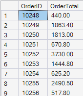


### Example 4: Total Spend per Customer

This is the total spend from each company, in descending order (highest to lowest).

```
SELECT c.CompanyName, SUM(od.Quantity * od.UnitPrice) AS TotalSpend
FROM Customers c
INNER JOIN Orders o
	ON c.CustomerID = o.CustomerID
INNER JOIN [Order Details] od
	On o.OrderID = od.OrderID
GROUP BY c.CompanyName
ORDER BY TotalSpend DESC
```

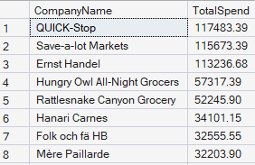


### Example 5: Customers with No Orders

Following example 4, now let's find the companies that may not have spent any money, as these are not shown in an inner join, since inner join only shows the matched values.
Remember to put IS for finding NULL values (always use IS or IS NOT)

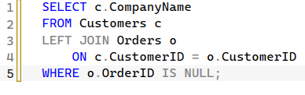

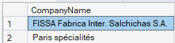


### Example 6: Products Never Ordered

What about products that have never been ordered from the stock? Similar to example 5:

```
SELECT p.ProductName
FROM Products p
LEFT JOIN [Order Details] od
	ON p.ProductID = od.ProductID
WHERE od.ProductID IS NULL;
```
There was nothing in the table so there must have been no products that have never been ordered.


### Example 7: Which customer bought the order and which employee processed them

This is a multi-dimensional query, where orders links to both customers and employees via foreign keys.
In this case we have one "fact" table (Orders) and then multiple "dimension" tables (Customers and Employees).

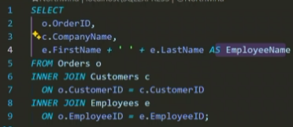

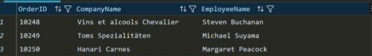

You can add:
```
GROUP BY e.FirstName, e.LastName
ORDER BY NumberOfOrders DESC;
```
To bring up employee name and how many orders they have done, to maybe check performance of the employees.

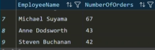

