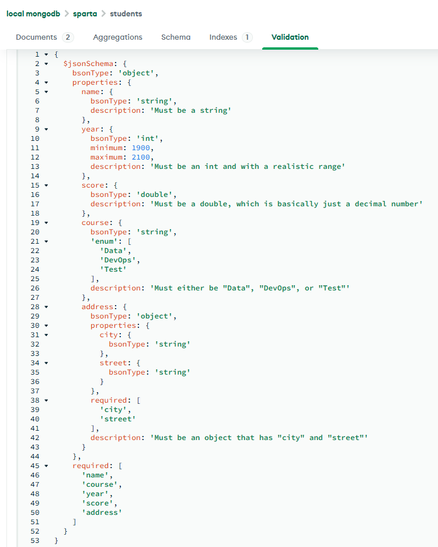

# MongoDB Tasks

# Validation rules

**a.** Set up more advanced validation rules on your "students" collection

**b.** Name required, must be string

**bsonType** just tells MongoDB that the entire document being inserted must be a JSON object

**required** is just a checklist of field names that must be present when a new document is added

**properties** is where you can add details to specific fields

```
properties: {
      name: {
        bsonType: 'string'
```
this tells MongoDB that the name field must be a string


**c.** Year required, must be int, must be in realistic range

use of minimum and maximum here
```
 properties: {
      name: {
        bsonType: 'string'
      },
      year: {
      	bsonType: 'int',
        minimum: 1900,
        maximum: 2100
      }
    },
    required: [
      'name',
      'course',
      'year'
```


**d.** Score required, must be a "double"

a double is just a decimal number, it's basically float
```
score: {
        bsonType: 'double'
      }
```


**e.** Course required, must be either "Data", "DevOps" or "Test"

using enum (which stands for enumeration) to restrict a field to a specific list of allowed values
before that for clarity and type enforcement I am adding the type to be string
```
course: {
        bsonType: 'string',
        'enum': [
          'Data',
          'DevOps',
          'Test'
        ]
      }
```


**f.** Address required, must be an object that has "city" and "street"

so inside of the main properties branch you are going to make one for address:
```
address: {
        bsonType: 'object',
        properties: {
          city: {
            bsonType: 'string'
          },
          street: {
            bsonType: 'string'
          }
        },
        required: [
          'city',
          'street'
        ]
      }
```
making each of city and street a string inside the object of address, and make them required inside the object, whilst later making address also required


**g.** Add a description to each property

```
{
  $jsonSchema: {
    bsonType: 'object',
    properties: {
      name: {
        bsonType: 'string',
        description: 'Must be a string'
      },
      year: {
        bsonType: 'int',
        minimum: 1900,
        maximum: 2100,
        description: 'Must be an int and with a realistic range'
      },
      score: {
        bsonType: 'double',
        description: 'Must be a double, which is basically just a decimal number'
      },
      course: {
        bsonType: 'string',
        'enum': [
          'Data',
          'DevOps',
          'Test'
        ],
        description: 'Must either be "Data", "DevOps", or "Test"'
      },
      address: {
        bsonType: 'object',
        properties: {
          city: {
            bsonType: 'string'
          },
          street: {
            bsonType: 'string'
          }
        },
        required: [
          'city',
          'street'
        ],
        description: 'Must be an object that has "city" and "street"'
      }
    },
    required: [
      'name',
      'course',
      'year',
      'score',
      'address'
    ]
  }
}
```



# Querying

**a.** Optional - Document basic queries we did on the star wars database
Did this on 'nosql.md'


**b.** List all comparison operators in Mongosh and use them all at least once

Name	Description
* $eq	Equal to
* $gt	Greater than
* $gte	Greater than or equal to
* $in	Matches values specified in an array
* $lt	Less than
* $lte	Less than or equal to
* $ne	Not equal to
* $nin	Matches none of the values in an array


**c.** We cannot us comparison operators on the "Height" field, why?
Find a way to fix this

It's because the height is a string and there are unknown heights

You could either remove the height's that are unknown first, then set to int:
```
db.characters.updateMany(
  {height: "unknown"},
  {$unset: {height: ""}}
)
db.characters.updateMany(
  {height:{$exists: true}},
  [{$set: {height: {$toInt: "$height"}}}]
)
```
...or using regex, which here is using if you find numbers from 0-9 make it int
```
db.characters.update(
  {height: /^[0-9]+$/},
  [{$set: {height: {$toInt: "$height"}}}],
  {multi: true}
)
```


**d.** Do the same thing you did for height, but for mass this time
https://regexr.com/
^^ regex help

**e.** Find the total height of all the humans in the database (aggregation)

Aggregation works in a pipeline process, so step by step, each step is provided in an array
When using aggregate, use $match to state what you are matching
id is required when using group, saying null means I don't want to split the data, total is just us naming the result as total, then just summing the height

```
db.characters.aggregate( [
  { $match: { "species.name": "Human"} },
  { $group: { _id: null, total: { $sum: "$height"} } }
  ] )
```

if for example instead of null, you put "$gender", it splits it into total height of male and female, so total human height by gender


**f.** Find the maximum height per homeworld

```
db.characters.aggregate([
  { $group: {_id: "$homeworld.name", max: {$max: "$height"}}}
])
```

**g.**
**h.** Find the distinct entries for "species.name"
```
db.characters.distinct("species.name")
```


**i.** Use .count({}) and .estimatedDocumentCount({})
What is the difference?

` db.characters.count({}) `


## Referencing

Embedding has less processing power as it only searches one document, but referencing searches multiple


Finding Darth Vader's ID
```
db.characters.findOne({ name: "Darth Vader" }, { _id: 1, name: 1 })
```

Creating the collection and inserting starships
`db.createCollection("starships")`

```
b.starships.insertOne({
  name: "TIE Advanced x1",
  model: "Twin Ion Engine Advanced x1",
  manufacturer: "Sienar Fleet Systems",
  length: 9.2,
  max_atmosphering_speed: 1200,
  crew: 1,
  passengers: 0,
  pilot: ObjectId("6ada15d47eeb439a775029be")
  })
```

  that long thing is me inserting the ObjectID I got from submitting part 1 earlier


Joining collections with lookup, like an SQL Join
```
db.starships.aggregate([
  {$lookup: {
    from: "characters",
    localField: "pilot",
    foreignField: "_id",
    as: "matched_pilot"
  }}
])
```