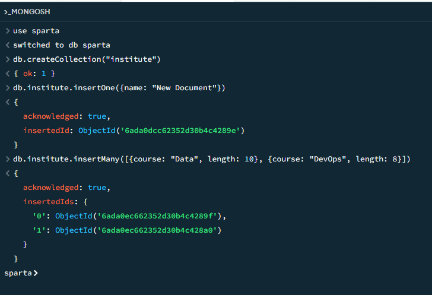

# NoSQL Introduction

## Scaling
* Horizontal is having more systems in case on fails
* Vertical is the same machine but scaling it to be bigger
* Relational databases usually use vertical as the databases can't really be strung out to multiple machines
* SQL uses table like schemas, communicates via Structured Query Language (SQL)

## What is NoSQL?
* Different structure (see the database types below), it's more flexible, less reliant on tabular form, dynamic schema
* NoSQL support many different ways that data can be stored and accessed, such as python, csv, json, javascript, c sharp, xml, etc.. thus is very accessible
* Horizontal scalability/scale-out
* Sharding and adding more servers, sharding is splitting up data across multiple machines
* More powerful

## Database Types
* **Key:Value stores**, KV pairs that are stored as objects, can be useful more metadata where you store descriptions about the data
* **Document databases**, extend the concept of key-value pairs, represented in JSON, XML, BSON/Binary JSON, organise documents into collections (similar to tables)
* **Column family database**, more niche, rows, row key, name value and timestamp, most popular one is Cassandra, doesn't have the rigid primary and foreign key structure
* **Graph stores**, nodes are connected by relationships, looks like a spider diagram, again not as important as the first two database types


# MongoDB



**Create:**
```
db.institute.insertOne({
  name: "Hitesh",
  course: "Data",
  trainer: {name: "Tommy", expertise: "Data"}
})
```

Validation - Generate rules via schema analysis from existing sample data or add them manually to enforce document structure during updates and inserts

```
db.createCollection("students")
{ ok: 1 }
db.students.insertOne({
  name: "Mr S. Global",
  course: "DevOps",
  year: NumberInt(2026),
  score: 88.2,
  address: {city: "Birmingham"}
})
```
**Read:**

` db.students.find({}) `

**Update/Unset:**
```
db.students.updateOne(
  {name: "Mr S. Global"},
  {$set: {score: 92.5, newField: null}}
)
```
```
db.students.updateOne(
  {name: "Mr S. Global"},
  {$unset: {newField: null}}
```
```
db.students.updateMany(
  {},
  {$set: {"year": NumberInt(2027)}}
)
```
**Delete:**
```
db.students.deleteOne(
  {name: "Mr S. Global"}
)
```

## Star Wars Dataset

```
use starwars
switched to db starwars
db.characters.find({name: "Luke Skywalker"})
```

Finding specific information, name: 1 just means yes I want name, like a boolean

`db.characters.find({name: "Chewbacca"}, {name: 1, eye_color: 1})`

Getting a key value pair from an embedded document, here the name is from species

`db.characters.find({name: "Ackbar"}, {name: 1, "species.name": 1, _id: 0})`

List all of the names and homeworld names for the humans on the database:

```
db.characters.find(
    { "species.name": "Human" },
    { name: 1, "homeworld.name": 1, _id: 0 }
)
```

```
db.characters.find(
    {eye_color: {$in: ["yellow", "orange"]}},
    {name: 1, eye_color: 1, _id: 0}
)
```

the and character filters on multiple things, e.g. blue eyes and female
```
db.characters.find(
    {$and: [{eye_color: "blue"}, {gender: "female"}]},
    {name: 1, eye_color: 1, gender: 1, _id: 0}
)
```


or: (so only need one or the other)
```
db.characters.find(
    {$or: [{eye_color: "blue"}, {gender: "female"}]},
    {name: 1, eye_color: 1, gender: 1, _id: 0}
)
```
